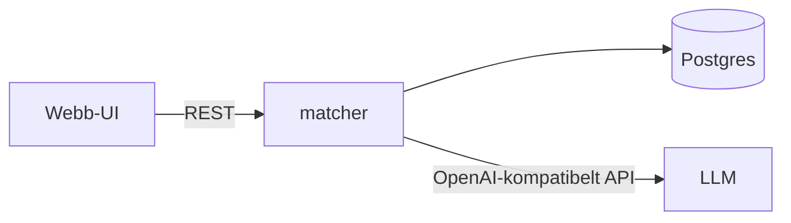

# Templates

Write headings and content in the team's language (Swedish shown here). Keep each file
short – these are working documents for a 2-hour build, not specifications for a year.

## docs/spec.md

Written in two parts: the requirements (problem, MVP, main flow, scope) in step 2, and
*Teknik*, *Arkitektur* and *Data* in step 3.

~~~markdown
# <Projektnamn>

## Problem och användare
<En mening: vem är användaren och vilket problem löser vi?>

## MVP
- <Funktion 1>
- <Funktion 2>

## Huvudflöde
1. <Vad användaren gör, steg 1>
2. <Steg 2>

## Utanför scope
- <Frestande sak vi medvetet skippar>

## Utbyggnader (om tid finns)
- <Stretch goal>

## Teknik
| Komponent | Språk/ramverk | Ansvar |
|---|---|---|
| <service> | <stack> | <vad den gör> |

Infrastruktur: <Kafka / Postgres / Ollama / ingen>. AI: <ingen / LLM / RAG / agent – modell>.
Önskemål: <vad teamet, eller enskilda medlemmar, vill lära sig, använda eller undvika>.

## Arkitektur


## Data
<Vilken data i data/ vi använder (kopierad från exempeldatan eller egen), format och antal poster.>
~~~

## docs/contract/

Only what crosses boundaries between workers. Concrete, with examples.

**`openapi.yaml`** – OpenAPI 3.1, one entry per endpoint consumed by another worker:
path, method, request/response schemas, one example each. Keep shared schemas under
`components/schemas`.

**`events.md`** – one section per Kafka topic:

```markdown
## Topic `job-ads.published`
- **Producent:** collector · **Konsumenter:** extractor
- **Nyckel:** `ad_id` (string)
- **Värde (JSON):**
  | Fält | Typ | Beskrivning |
  |---|---|---|
  | ad_id | string | Unikt id |
  | title | string | Annonsrubrik |
  | text | string | Annonstext |
  | published_at | string (ISO 8601) | Publiceringstid |
- **Exempel:** `{"ad_id": "a-1", "title": "Python-utvecklare", "text": "…", "published_at": "2026-10-16T09:00:00Z"}`
```

**`models.md`** – shared data models (if not already covered by OpenAPI schemas).

**Agent tools** (if an agent calls other workers' code) – signature, description,
arguments, return value, example.

## docs/plan.md

See [work-split.md](work-split.md) for how to decide the split.

```markdown
# Plan och arbetsfördelning

## Team
| Namn | GitHub | Paket | Gren |
|---|---|---|---|
| Anna Andersson | @anna-a | Matchning | anna/matcher |

## Arbetspaket
| Paket | Äger (sökvägar) | Levererar (gränssnitt) | Använder (gränssnitt) |
|---|---|---|---|
| Matchning | services/matcher/ | GET /matches | profiles-modell |

## Uppgifter
### Matchning (Anna)
0. Skelett (klart): `GET /matches` svarar med stubbdata
1. [MVP] …
2. [MVP] …
3. [Utbyggnad] …

## Delade filer
`compose.yaml`, `.env.example`, `AGENTS.md`, `docs/contract/` – ändras i små separata
commits, mergas snabbt, säg till i teamet. Kontraktsändringar kräver teamets ok.

## Integration
- Före avstämning 2: <vad ska vara mergat till main och fungera ihop>
- Mot slutet: <huvudflödet fungerar från main>

## Kända problem
- <t.ex. något som inte startade vid scaffolding – ägare>
```

## AGENTS.md – Project section

Replace the placeholder under `## Project` (keep the rest of AGENTS.md intact):

```markdown
## Project

**<Name>** – <one-line goal>. Spec: `docs/spec.md` · Plan and ownership: `docs/plan.md` ·
Contract (if any): `docs/contract/`.

### Team
| Name | GitHub | Owns |
|---|---|---|
| Anna Andersson | @anna-a | services/matcher |

### Components
| Service | Path | Stack | Port |
|---|---|---|---|
| matcher | services/matcher | Python/FastAPI | 8000 |

### Setup
Tools and versions every member needs: <e.g. Python 3.13 via uv, Node 24 LTS>, a
container runtime with compose, <Ollama with `ollama pull <model>` if AI is used>.
Versions are pinned in <e.g. `.python-version`, `.nvmrc`>. Then `cp .env.example .env`.

### Commands
- Start everything: `podman compose up -d --build` (or `docker compose …`)
- Stop everything: `podman compose down` (or `docker compose …`)
- Run a service locally: see `services/<name>/README.md`
- Quality gates per service (run before committing): <test, lint and format-check
  commands, e.g. `uv run pytest && uv run ruff check && uv run ruff format --check`>

### Conventions
- <Any team-specific decision, e.g. "all timestamps ISO 8601 UTC">
```

## README.md

~~~markdown
# <Projektnamn>

<Vad det gör, 1–2 meningar.> Byggt av <team> på NOIRs höstkonferens 2026.

## Kör
```bash
cp .env.example .env
podman compose up -d --build   # starta
podman compose down            # stoppa
```

<Var man ser resultatet, t.ex. http://localhost:8000/docs>

## Utveckla
Tester och quality gates, ett block per tjänst:
```bash
cd services/<name>
uv run pytest                 # tester
uv run ruff check             # linting
uv run ruff format --check    # formatering
```

Andra fungerande alternativ går också bra; lägg till kommandon här om de skiljer sig.

## Dokumentation
- [Spec](docs/spec.md) · [Plan](docs/plan.md) · [Kontrakt](docs/contract/)
- [Konferensmaterial](konferens/)
~~~
