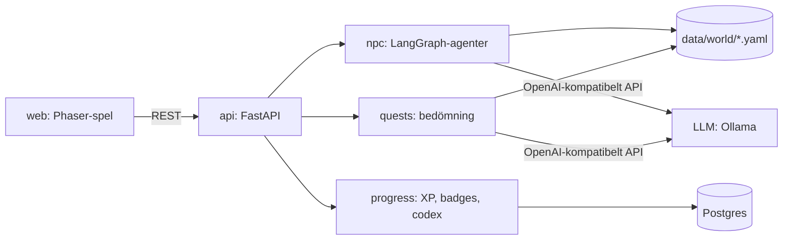

# Kunskapsriket

Ett utforskande 2D-RPG där seniora systemutvecklare lär sig AI-koncept och moderna
arbetssätt genom att prata med AI-mentorer, klara quests och samla kunskap.

## Problem och användare
NOIRs konsulter, särskilt seniora systemutvecklare, behöver anpassa sig till nya trender
och arbetssätt (kodagenter, prompting, RAG, agenter), men kurser och quiz känns tråkiga.
Kunskapsriket låter dem utforska ämnena i egen takt i ett spel där framstegen syns och
belönas.

## Zoner och mentorer
| Zon | Mentor (exempel) | Ämnen |
|---|---|---|
| Agentbyn | Ada, kodagentveteranen | Kodagenter i vardagen, planera → bygga → granska, AGENTS.md, granska AI-kod |
| Prompttornet | Kontext-Karl | Prompt- och kontext-engineering, tokens, kontextfönster, hallucinationer |
| RAG-biblioteket | Bibliotekarien Vera | Embeddings, vektorsök, RAG, när RAG passar och inte |
| Verktygssmedjan (valfri 4:e) | Smeden Mo | Tool calling, MCP, agenter vs. arbetsflöden |

## MVP
- 2D-tilekarta (Phaser) med 3 zoner och 3–4 NPC-mentorer. Man går med piltangenterna
  och pratar med `E`.
- NPC-dialog via LLM: varje mentor har en persona och ett ämne, förklarar, svarar på
  fria frågor, håller sig till sitt ämne, minns samtalet under sessionen och anpassar
  förklaringen till en senior utvecklare.
- En quest per NPC: mentorn ger ett uppdrag (förklara, lös eller välj), LLM:en bedömer
  svaret (godkänt / inte än) och ger feedback. Man kan försöka igen.
- Belöningar: XP och nivå, ett kunskapskort i codexen per klarad quest, några
  badges/achievements med enkla regler.
- Framsteg sparas per spelare (bara namn, ingen inloggning) och visas i en HUD (XP, nivå,
  codex, badges).

**Codex:** spelarens samling av kunskapskort (kort sammanfattning av begreppet, när det
passar, fallgropar, vem som lärde ut det). Öppnas med `C`. Ej upplåsta kort visas som
"???", så att det lockar till utforskning.

## Huvudflöde
1. Spelaren anger sitt namn och hamnar i världen. HUD:en visar XP, nivå och badges.
2. Hen går fram till en mentor, pratar och ställer egna frågor om ämnet.
3. Hen tar mentorns quest, svarar och får feedback. Vid godkänt ges XP och ett kunskapskort.
4. Achievements låses upp ("Första questen!", "Agentbyns hjälte") och framstegen finns
   kvar nästa gång.

## Utanför scope
- Tävling mot andra, topplistor och streaks
- Inloggning och konton
- Egen grafik (gratis tileset eller färgade rutor räcker), ljud, mobilstöd
- Flera kartor som laddas in

## Utbyggnader (om tid finns)
- Zoner som låses upp med nivå/XP
- NPC:er som minns tidigare samtal mellan sessioner
- Quests i flera steg, kodquests som faktiskt körs
- Codex med AI-sammanfattning av vad du lärt dig
- Fler zoner som genereras från ämnesbeskrivningar
- Inventory/items, anpassad svårighetsgrad

## Teknik
| Komponent | Språk/ramverk | Ansvar |
|---|---|---|
| web | TypeScript, Vite, Phaser 3 (Node 24 LTS) | Spelet: karta, rörelse, NPC:er, dialogpanel, HUD, codex |
| api | Python 3.13, FastAPI, LangGraph, `langchain-openai` (uv) | Moduler: `npc` (mentoragenter), `quests` (bedömning), `progress` (XP, nivåer, badges, codex), `world` (innehåll) |
| postgres | PostgreSQL 18 | Spelarnas framsteg |

Infrastruktur: Postgres. AI: LangGraph-agenter för mentorerna och LLM-bedömning av quests
via OpenAI-kompatibelt API (`LLM_BASE_URL`, `LLM_MODEL`, `LLM_API_KEY`). Standard är Ollama
på datorn med `qwen3.6`; molnnyckel (t.ex. Gemini) går att byta till.

Mentoragentens verktyg: `get_player_progress()`, `offer_quest()`, `lookup_card(topic)`.
Minne under sessionen via LangGraphs checkpointer (en tråd per spelare och mentor).

Önskemål: lära sig agenter med LangGraph. Inget tävlande och inga streaks.

## Arkitektur

Flöde: `E` vid en mentor → `POST /npcs/{id}/chat` → mentoragenten svarar (och kan erbjuda
questen) → spelaren svarar → `POST /quests/{id}/attempt` → LLM bedömer → vid godkänt ger
`progress` XP, kunskapskort och badges → HUD uppdateras.

## Data
Världsinnehållet ligger i `data/world/` som YAML: zoner, mentorer (persona, ämne,
position), quests (uppdrag och bedömningskriterier), kunskapskort och achievement-regler.
Det genereras för projektet; exempeldatan från mallen (CV:n, annonser) används inte.
Spelarframsteg lagras i Postgres.
